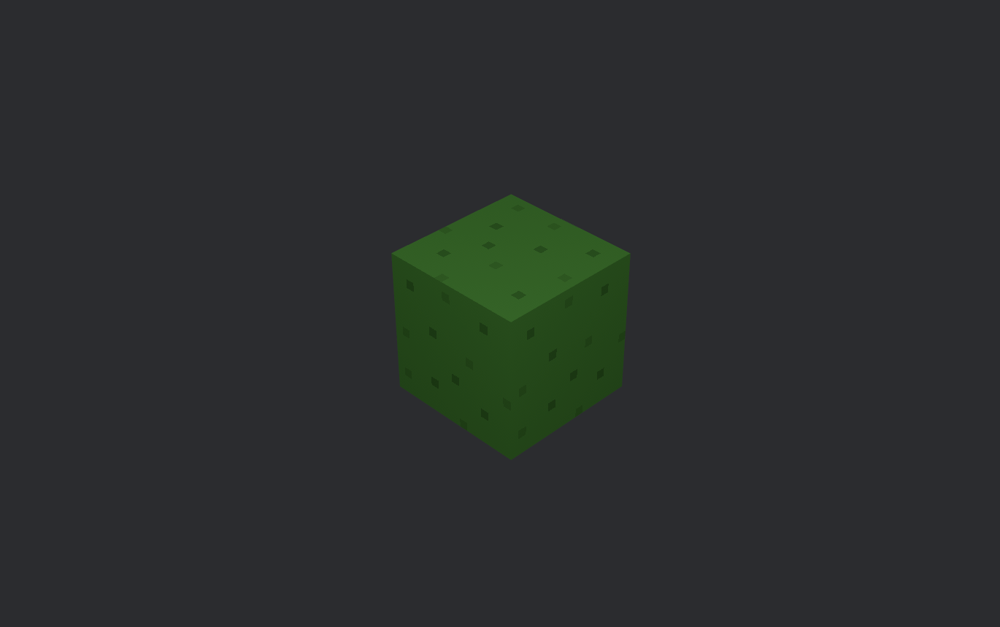

## Getting started

This guide will show you how to get started building voxel games with Bevy and `bevy_voxel_world`. If you are new to Bevy, I strongly reccommend that you go through [Bevys getting started guide](https://bevy.org/learn/quick-start/introduction/) first. This guide assumes you have a working setup and at least a basic understanding of the Bevy game engine and the Rust programming language.

## Setting up a voxel world

Let's start with a minimal Bevy app:

```rust
use bevy::prelude::*;

fn main() {
    App::new()
        .add_plugins(DefaultPlugins)
        .run();
}
```

Check that everything compiles and the app start:

```bash
$ cargo run -r
```

So far, our game does nothing, so you should see an empty gray window open once the compile has completed.

Next, we'll add the `bevy_voxel_world` plugin. At minimum, you need two things: The plugin itself and a config struct that implements the `VoxelWorldConfig` trait.

The minimum impl of the trait require two associated types. `MaterialIndex` declares the Reust type used to store the material for each voxel, and `ChunkUserBundle` declares a type you can use to insert custom data into chunks. For now we won't use it, but Rust requires it to be declared in all implementations of the trait.

The code now looks like this:

```rust
use bevy::prelude::*;
use bevy_voxel_world::prelude::*;

// Define a struct to hold our config
#[derive(Resource, Clone, Default)]
struct MyWorld;

// Implement the VoxelWorldConfig trait for MyWorld.
// This is where bevy_voxel_world will be configured.
impl VoxelWorldConfig for MyWorld {
    type MaterialIndex = u8; // We'll configure this properly in the Texturing chapter!
    type ChunkUserBundle = ();
}

fn main() {
    App::new()
        .add_plugins(DefaultPlugins)
        // Add the voxel world plugin with the MyWorld config
        .add_plugins(VoxelWorldPlugin::with_config(MyWorld))
        .run();
}

```

The config struct does two things:

- It supplies the configuration values
- Its type also acts as a world instance identifier. If you need to use multiple voxel worlds in the same app, you add the plugin multiple times with different config structs.

## Adding voxels

Ok, now we're ready to do something more interesting!

Let's add a setup system that adds a camera, a light, and a voxel to the world.

```rust
fn setup(mut commands: Commands, mut voxel_world: VoxelWorld<MyWorld>) {
    // Camera
    commands.spawn((
        Camera3d::default(),
        Transform::from_xyz(5.0, 5.0, 5.0).looking_at(Vec3::ZERO, Vec3::Y),
        // This tells bevy_voxel_world to use this cameras transform to calculate spawning area
        VoxelWorldCamera::<MyWorld>::default(),
    ));

    // light
    commands.spawn((
        PointLight {
            shadow_maps_enabled: true,
            ..default()
        },
        Transform::from_xyz(4.0, 8.0, 4.0),
    ));

    // Finally, a voxel!
    voxel_world.set_voxel(IVec3::new(0, 0, 0), WorldVoxel::Solid(0));
}
```

Notice the second param used in the setup system: `mut voxel_world: VoxelWorld<MyWorld>`

This is how you gain access to the voxel world. The type param is the type of the config struct, and it selects which voxel world the param will access.

Also notice the third component added to the camera entity: `VoxelWorldCamera::<MyWorld>::default()`

This is how `bevy_voxel_world` knows that chunks of voxels should be spawned for `MyWorld` when they are in view of this camera.

Finally, at the end of the function, we set a single voxel in the center of the world.

To run the system, register it in the `Startup` schedule:

```rust
fn main() {
    App::new()
        .add_plugins(DefaultPlugins)
        .add_plugins(VoxelWorldPlugin::with_config(MyWorld))
        // Register the setup system here!
        .add_systems(Startup, setup)
        .run();
}
```

Now when you run the game you should see a single voxel in the center of the screen. Yay!



You may be wondering where the texture for this voxel comes from. This is just a basic default texture built in to `bevy_voxel_world`, meant to make it easy to get started. In a later chapter, we'll go over how to set up your own materials with custom textures.
