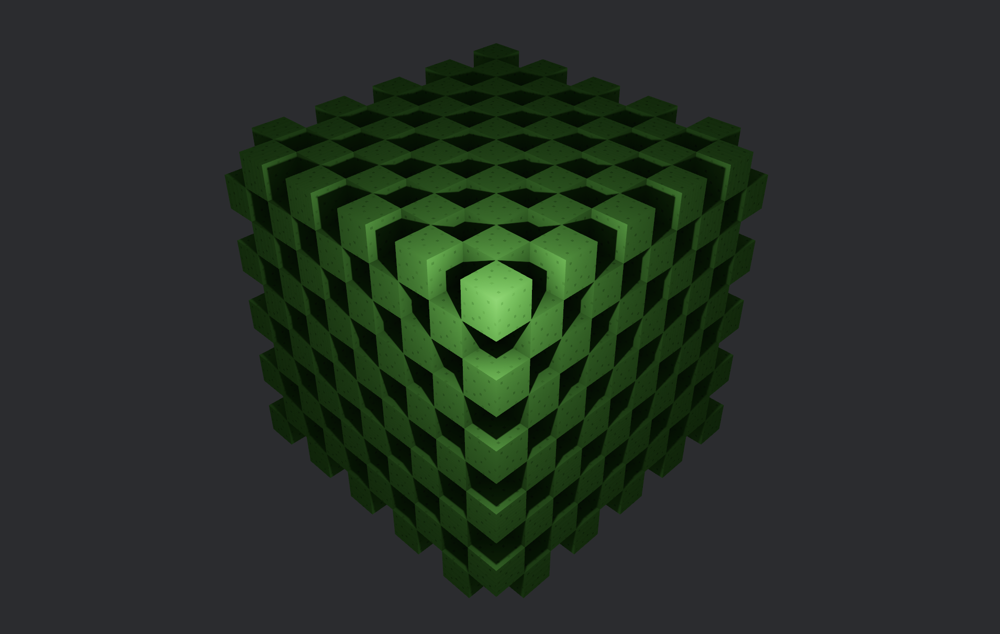

## Editing voxels

As we saw in the Hello voxel chapter, `set_voxel` can be used to set a voxel in the world:

```rust
// Setting a voxel
voxel_world.set_voxel(IVec3::new(0, 0, 0), WorldVoxel::Solid(0));
```

This is called a *voxel edit*, and here it sets a solid voxel of material index 0. Whenever a voxel is edited, the chunk it belongs to is scheduled for re-meshing, so that the change is reflected in the rendered world over the next frame or two. Re-meshing happens in the task pool, off the main thread, so this work can span multiple frames whithout causing visible framedrops in your game.

The voxel data in `bevy_voxel_world` is layered in a generated layer and an edit layer. If a solid voxel is generated at a location, and an edit sets the voxel there to Air, no voxel will be rendered. The edit layer always wins over the generated layer. We'll get into generating voxels in the next chapter, but the important thing to understand about this layered setup is that worlds can be both infinitely large and editable at the same time, and only need memory for the voxels that are visible on the screen, plus the stored edits.

## Reading voxels

As you may expect, reading a voxel is done by calling `get_voxel`:

```rust
// Getting a voxel
let voxel = voxel_world.get_voxel(IVec3::new(0, 0, 0));
println!("{:?}", voxel); // Solid(0)

let no_voxel = voxel_world.get_voxel(IVec3::new(1, 1, 1));
println!("{:?}", no_voxel); // Unset
```

Given a location, it returns what kind of voxel is there, or `WorldVoxel::Unset` if there is none. `WorldVoxel::Air` is another way for locations to be empty, but `Air` is explicitly set, whereas `Unset` is everywhere a voxel has never been set or generated (or explicitly set to `Unset`).

## Batch editing voxels

Often, you'll need to set multiple voxels at the same time. For this you can use `set_voxels_in`. This allows `bevy_voxel_world` to handle large edits more efficiently.

```rust
// Setting a range of voxels
voxel_world.set_voxels_in(IVec3::new(-5, -5, -5), IVec3::new(5, 5, 5), |pos| {
  if (pos.x.abs() + pos.y.abs() + pos.z.abs()) % 2 == 0 {
    Some(WorldVoxel::Solid(0))
  } else {
    None
  }
});
```



## Animating voxels

Chunks re-mesh once per frame, which means you can "animate" with voxels. Try putting this system in the `Update` schedule to see this in action:

```rust
fn animate_voxels(mut voxel_world: VoxelWorld<MyWorld>, time: Res<Time>) {
    let t = time.elapsed_secs();
    voxel_world.set_voxels_in(IVec3::new(-10, -10, -10), IVec3::new(5, 5, 5), |pos| {
        if ((pos.x as f32 + t * 5.0).cos() * 2.0
            + (pos.y as f32 - t * 5.0).sin() * 2.0
            + (pos.z as f32 + t * 5.0).cos() * 2.0)
            .abs()
            > 1.0
        {
            Some(WorldVoxel::Solid(0))
        } else {
            Some(WorldVoxel::Unset)
        }
    });
}
```

For a more advanced voxel animation example, [check out this](/bevy_voxel_world/docs/examples/#voxel_animation)
