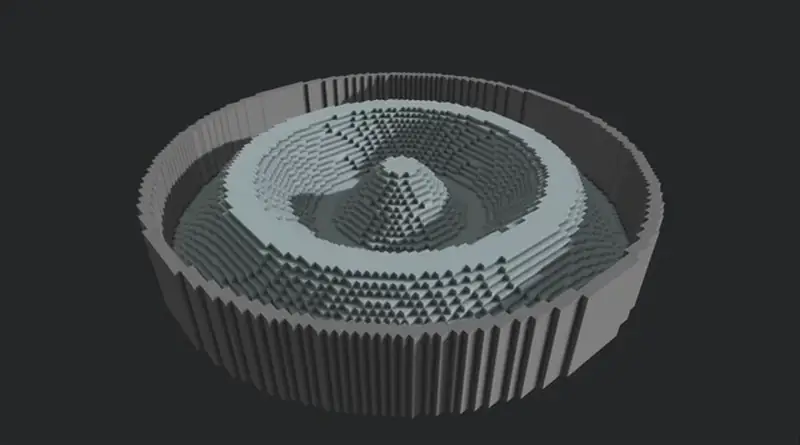

To access a voxel world instance in a system, you can use the `VoxelWorld` system param. `VoxelWorld` take one type parameter, which is the configuration struct for the world you want to access.

The `set_voxel` and `get_voxel` access functions can be used to manipulate the voxel data in the world.

```rust
fn my_system(mut voxel_world: VoxelWorld<MyWorld>) {
    voxel_world.set_voxel(IVec3 { ... }, WorldVoxel::Solid(0));
}
```

This will update the voxel value at the given location in the persisting `HashMap`, and cause `bevy_voxel_world` to queue the affected chunk for re-meshing.

Voxels are keyed by their XYZ coordinate in the world, specified by an `IVec3`. The type of voxel is specified by the `WorldVoxel` type. A voxel can be `Unset`, `Air` or `Solid`.


