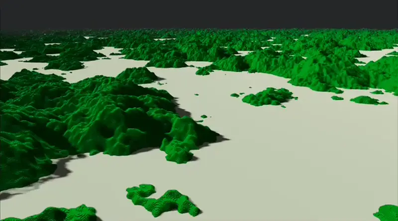

Every chunk has a LOD level. A level-0 chunk is 32 voxels on a side and samples every voxel. A chunk at level `L` is `32 << L` voxels on a side and, by default, samples every `1 << L` voxels, so it holds as many samples as a level-0 chunk. Far regions therefore cost about as much as near ones, which lets a world stream out to a distant horizon.

To use LOD levels, override `VoxelWorldConfig::chunk_lod` and return the level wanted at a chunk position. The default returns `0` everywhere. The level must not get finer with distance. Check out the `noise_terrain_lod` example to see this in action.

When the level at a position changes, chunks at the new level spawn first, and the old ones are despawned once the new ones cover them, so no hole opens.

A chunk is addressed by a `ChunkKey`, which holds its position and its level. Chunk messages carry one, and `VoxelWorld::chunk_at` returns the key of the finest chunk covering a voxel.

Other `VoxelWorldConfig` methods that matter with LOD levels:

- `chunk_data_shape` and `chunk_meshing_shape` can be used for sampling a level more or less densely than the default.
- `voxel_lookup_delegate` is called with world positions, so it works unchanged at every level.
- `chunk_meshing_delegate` builds its mesh as for a level-0 chunk, and the crate scales it to the chunk's size. A custom mesher should scale its own texture coordinates with `scale_texture_coordinates`.
- `chunk_fill_hint` is an opt-in optimization that lets a world hint at the contents of a chunk. By hinting that a chunk is either 100% air or 100% solid material, the chunk streaming policy can decide to skip over it or stop at it, thereby avoiding unnecessary work.

The consuming code is responsible for hiding seams between levels. `examples/noise_terrain_lod.rs` streams terrain 500 chunks out in six levels, uses fill hints, and hides cracks with skirts by returning `WorldVoxel::Unset` in the padding of its level-1 chunks.
