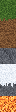
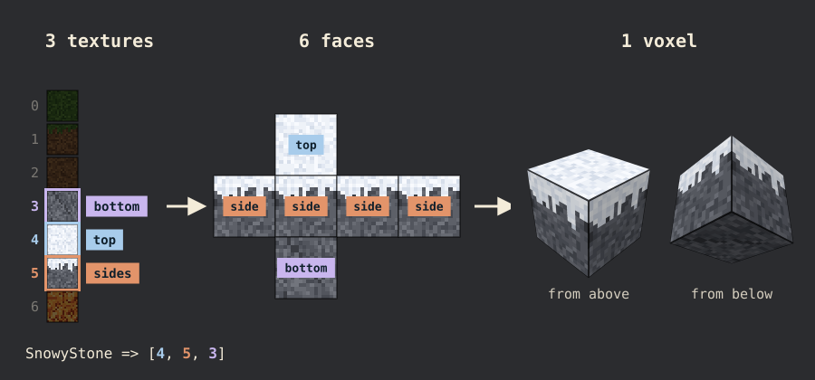
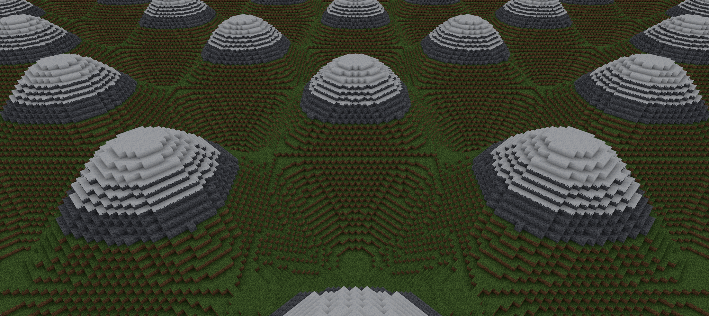

## Texturing your world

Infinite green sine hills looses their appeal quite quickly, especially when they're all the same color. In this chapter we'll look at how you can bring different materials with their own unique textures into the world.

To do this, we'll declare a few different materials, and load up an array texture to represent them.

This is the texture we'll use:
<center></center>

You can right click on the image and download it. This texture was generated from a Python script written by Claude Code, so feel free to use it how ever you like. This is a fairly low-res texture, and it gives a pixelated style to the voxels. However, you can use any resolution you want for the texture. It will scale to fit automatically.

## Setting up materials

First, we can declare an Enum that holds our different materials:

```rust
#[derive(Debug, Clone, Copy, Hash, Eq, PartialEq, Default)]
enum MyWorldMaterial {
    #[default]
    Grass,
    Dirt,
    Stone,
    Snow,
    SnowyStone,
    Lava
}
```

This enum is how we'll distinguish which material a voxel is made off.

We can now let our `VoxelWorldConfig` know the type of our material Enum:

```rust
impl VoxelWorldConfig for MyWorld {
    type MaterialIndex = MyWorldMaterial; // <- Like this
    type ChunkUserBundle = ();
    // ...
}
```

## Setting up and mapping the textures

Now that we have declared a material Enum, we need to say which textures each material should use. So we need to load the PNG image for the texture and set up a `texture_index_mapper` function in our config.

### The texture image
```rust
fn voxel_texture(&self) -> Option<(String, u32)> {
    Some(("texturing.png".into(), 7)) // <- Our texture has 7 indexes
}
```
This tells BVW the name of our texture image file, and how many layers it has. Here we say 7, since the image contains seven different individual textures.

This information will be used by BVW to configure an array texture, very similarly to what this Bevy example does: https://bevy.org/examples/shaders/array-texture/

### The mapper function

Next, we need to say how those array texture indexes map to each voxel material. This is done through the `texture_index_mapper` function:

```rust
fn texture_index_mapper(
    &self,
) -> Arc<dyn Fn(Self::MaterialIndex) -> [u32; 3] + Send + Sync> {
    Arc::new(|vox_mat| match vox_mat {
        MyWorldMaterial::Grass      => [0,1,2],
        MyWorldMaterial::Dirt       => [2,2,2],
        MyWorldMaterial::Stone      => [3,3,3],
        MyWorldMaterial::Snow       => [4,4,4],
        MyWorldMaterial::SnowyStone => [4,5,3],
        MyWorldMaterial::Lava       => [6,6,6]
    })
}
```

If this looks complicated, with all the numbers and stuff, fear not! It's quite simple.

In BVW, each voxel has a combination of three textures: One on top, one on the sides, and one on the bottom. The array slice returned from the mapper says which index to use for each of those: `[top, sides, bottom]`

Take the `SnowyStone` material for instance:



We point to index 4 for the top, 5 for the sides and three for the bottom.

So in other words, each material is textured through a composition of textures in the array texture, and any combination of those can be used.

Put both the texture image and the mapper in your config from the sine hills world from the previous chapter:

```rust
impl VoxelWorldConfig for MyWorld {
    type MaterialIndex = MyWorldMaterial; // <- Like this
    type ChunkUserBundle = ();

    fn voxel_texture(&self) -> Option<(String, u32)> {
        // ...
    }

    fn texture_index_mapper(
        &self,
    ) -> Arc<dyn Fn(Self::MaterialIndex) -> [u32; 3] + Send + Sync> {
        // ...
    }

    fn voxel_lookup_delegate(&self) -> VoxelLookupDelegate<Self::MaterialIndex> {
        // ...
    }
}
```

## Using the materials

Now you'll notice that Rust complains about `WorldVoxel::Solid(0)`. That's because there is no longer a material `0`. Update the Voxel lookup closure to return `WorldVoxel::Solid(MyWorldMaterial::Grass)` instead. This is how you can now use the materials you created!

Now try updating the generator to use a few of the materials:

```rust
// Nice wavy sine hills with snowy peaks!
if (pos.y as f32)
    < (pos.x as f32 / scale).sin() * scale + (pos.z as f32 / scale).sin() * scale
{
    if pos.y > 12 {
        return WorldVoxel::Solid(MyWorldMaterial::Snow);
    }
    if pos.y > 8 {
        return WorldVoxel::Solid(MyWorldMaterial::SnowyStone);
    }
    if pos.y > 5 {
        return WorldVoxel::Solid(MyWorldMaterial::Stone);
    }
    return WorldVoxel::Solid(MyWorldMaterial::Grass);
}
```

Behold, sine hills with snowy peaks!



That's it! Now you know the basics of materials and texturing with `bevy_voxel_world`. Beyond these basics, it's also possible to configure your own custom Bevy materials to use, which enables custom shaders. But that's a topic for a later chapter!
