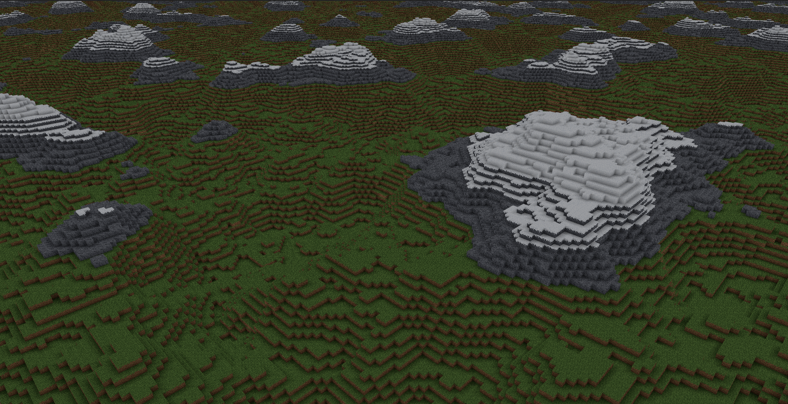

## Beyond sine hills

As nice and wavy as those sine hills are, they do feel just a tiny bit repetitive. I mean, it's literally the same thing over and over again, forever, end ever, end ever. So let's make it a bit more interesting by generating our terrain from a noise height map instead!

To make our noise, we'll use a crate called [`quick_noise`](https://github.com/Alysara/quick-noise). The `quick_noise` crate contains various highly optimized noise algorithms, which is super convenient in our case, because we can skip all the intricasies of generating noise performantly ourselves. Which is good, because this tutorial is not actually about _making_ noise, it's about _using_ noise.

Add the `quick_noise` crate:

```bash
$ cargo add quick_noise
```

And import this from it:

```rust
use quick_noise::{Fbm, Grid, Perlin};
```

We'll also need to get the chunk size from `bevy_woxel_world`. The size is 32, and we could juts hard code it, but as good practice, let's import the constant:

```rust
use bevy_voxel_world::custom_meshing::{CHUNK_SIZE_I}; // the I just means it's an i32.
```

## Making some noise!

With `quick_noise` installed and imported, let's configure some noise. First, we'll create a struct to hold our noise:

```rust
struct ChunkHeightmap {
    min: IVec2, // This will be set to the x/z position of the first column of the chunk
    heights: Vec<f32>, // And the y positions go in here. That's our noise.
}
```

Now we also need to generate the noise and provide a way to access it from the Voxel lookup closure:

```rust
// Chunks are sampled with a padding of one voxel on each side. That's
// required so that the mesher knows wheter to fill in the sides when
// a wall is right on the edge.
const PADDED_SIZE: u32 = CHUNK_SIZE_U + 2;

// We'll scale the y position by this value. This controls how high the
// mountains are, and how deep the valleys.
const TERRAIN_HEIGHT: f32 = 32.0;

impl ChunkHeightmap {
    fn new(chunk_pos: IVec3) -> Self {
        let min = chunk_pos.xz() * CHUNK_SIZE_I - 1;

        // quick_noise pre-generates a grid of noise upfront. We set the
        // grid to the padded size, so that there is enough to fill the
        // entire chunk plus the padding.
        let heights = Grid::<2>::new(PADDED_SIZE, PADDED_SIZE)
            // The world position of this chunk's corner
            .sample_position(min.x, min.y)

            // These params control the look of the noise.
            // Check the `quick_noise` docs for more info on what they do!
            .seed(1234)
            .builder::<Fbm, Perlin>()
            .octaves(5)
            .frequency(1.0 / 64.0)
            .build();

        Self { min, heights }
    }

    /// This is how we get the noise. It returns the y value
    /// for a given x and z
    fn height_at(&self, x: i32, z: i32) -> f32 {
        let gx = (x - self.min.x) as usize;
        let gz = (z - self.min.y) as usize;
        
        // The noise is built as a flat array, so we can index
        // a postion into it like this
        self.heights[gz * PADDED_SIZE + gx] * TERRAIN_HEIGHT
    }
}
```

## Sampling the noise

Now we can sample our noise in the voxel lookup closure:

```rust
fn voxel_lookup_delegate(&self) -> VoxelLookupDelegate<Self::MaterialIndex> {
    Box::new(move |chunk_pos, _lod, _previous| {

        // Finally we have a use for the Chunk closure! We can build the
        // noise here. This is a lot faster than building noise for every
        // voxel. We do it once here, and then sample it 32768 times in
        // the Voxel closure.
        let heightmap = ChunkHeightmap::new(chunk_pos);

        Box::new(move |pos: IVec3, _previous| {
            
            // Similar to before, we make everything below the threshold
            // solid. Except now, the threshold is from the noise instead
            // of a sine function!
            if (pos.y as f32) < heightmap.height_at(pos.x, pos.z) {
                if pos.y > 12 {
                    return WorldVoxel::Solid(MyWorldMaterial::Snow);
                }
                if pos.y > 8 {
                    return WorldVoxel::Solid(MyWorldMaterial::SnowyStone);
                }
                if pos.y > 4 {
                    return WorldVoxel::Solid(MyWorldMaterial::Stone);
                }
                return WorldVoxel::Solid(MyWorldMaterial::Grass);
            }

            // Everything else is left unset
            WorldVoxel::Unset
        })
    })
}
```

Behold, noise hills with snowy peaks!



I'll leave it to you to figure out a good camera angule to view your nice noise landscape.

You can also try increasing the spawning distance. Put this in your config:

```rust
fn spawning_distance(&self) -> u32 {
    25 // this will spawn chunks up to a distance of 25 chunks, about 25 * 32 = 800 voxels
}
```

Really high values here will get slow, and if you need really huge viewing distance, you'll need to use LODs (Level of Detail). We'll take a look at this in the next chapter!
