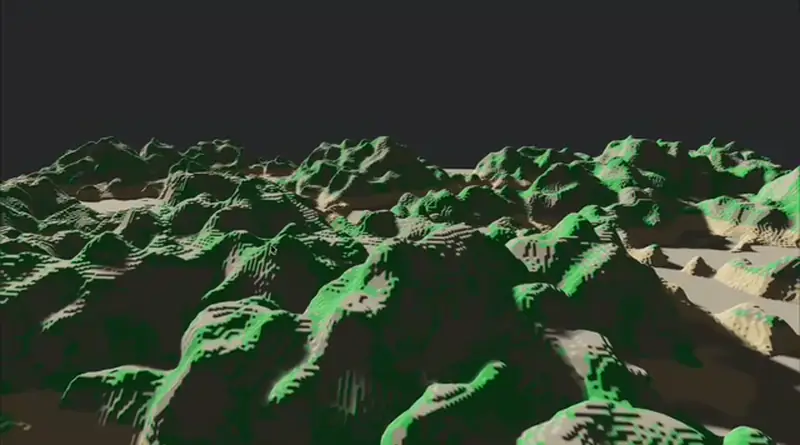

Custom meshing is supported though a delegate function that can be specified in the config. The function recives an array of voxel data for the chunk to be meshed, and a reference to the texture index mapper functon. This delegate is then called from a thread in the task pool and needs to return a Bevy Mesh that can be inserted on the chunk entity.

The meshing delegate function can also return a Bevy component or bundle that will be inserted along with the mesh. This is useful for generating additional data based on the meshing data, such as nav meshes. It can be beneficial to do all such processing at once, while the voxel data is already hot in the caches.

See this [full example of custom meshing](https://github.com/splashdust/bevy_voxel_world/blob/main/examples/custom_meshing.rs) for more details.

## Other shapes

The delegate doesn't have to produce cubical voxels. The [marching cubes example](https://github.com/splashdust/bevy_voxel_world/blob/main/examples/marching_cubes.rs) turns each chunk's voxels into a density field and extracts a smooth surface with the [transvoxel](https://crates.io/crates/transvoxel) crate, rendered with a `StandardMaterial` and vertex colours instead of the default voxel material.
