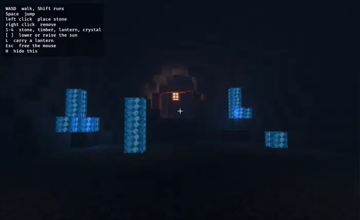

`bevy_voxel_world` supports voxel light propagation through an opt-in crate feature: `light_propagation`

```bash
$ cargo add bevy_voxel_world --features light_propagation
```

Two kinds of light propagates: Sky light and voxel light

- Sky light falls straight down from open sky and then spreads sideways under overhangs.
- Voxel light spreads out from emissive voxels.

## Enable light propagation

A world opts in on its own by returning a config from [`VoxelWorldConfig::light_propagation`]:

```rust
impl VoxelWorldConfig for MyWorld {
    // ...
    fn light_propagation(&self) -> Option<LightPropagation> {
        Some(LightPropagation::default())
    }

    fn emissive_materials(&self) -> Vec<(u8, Emission)> {
        vec![(LAMP, Emission::level(15.0))]
    }
}
```

By default, the `light_propagation` method returns `None`, which means no light computaion is done, and no performance cost is payed.

When Some config is returned, the light calculations are performed in the chunk tasks, and chunk computation will be slightly slower as a result.

Every setting is documented in [`LightPropagation`], along with what light can't do. The [`light_tuning` example](https://github.com/splashdust/bevy_voxel_world/blob/main/examples/light_tuning/main.rs) puts every setting in a panel that says what it does and where in its world to look for the change. Use the example to test out values interactiely to better understand the config options.

```bash
$ cargo run -r --example light_tuning --features light_propagation,sub_grids
```

## Light demo

The [`light_mountain_house` example](https://github.com/splashdust/bevy_voxel_world/blob/main/examples/light_mountain_house.rs) demoes the `light_propagation` feature together with Bevy's atmosphere, fog and point lights, and let's the player ad and remove regular and emissive voxels to see how lighting propagates. Its trees can be felled, which uses the `sub_grids` and `dislodged_fragments` features too.



```bash
$ cargo run -r --example light_mountain_house --features light_propagation,sub_grids,dislodged_fragments
```
